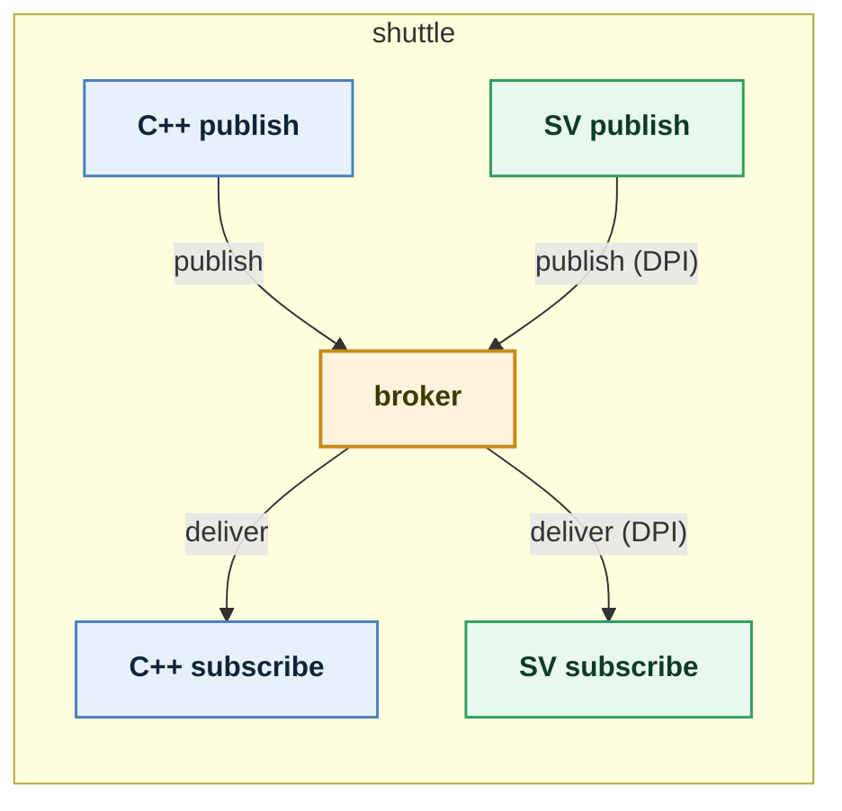

# shuttle

English | [简体中文](README_zh.md)

A **typed publish-subscribe framework** for EDA verification environments. C++ components,
SystemVerilog components, and C++ ↔ SV crossings all communicate through one broker, one type
system, and one delivery semantics, on either the `svdpi` or the `systemc` backend.



Every path goes through the single broker: in-language delivery needs no bridge, cross-language
delivery crosses the DPI boundary (svdpi backend). Shuttle is not an RPC framework, not a bus
functional model, and not a UVM layer — it owns exactly one thing: which of a frame's matching
subscribers are called, when, through which entry, and with what recorded outcome. All concurrency
orchestration (tasks, time, events) is delegated to [weave](https://github.com/kpskp77/weave).

## shuttle ↔ subject-based messaging mapping

Shuttle's API semantics follow subject-based publish-subscribe (NATS-style topics, MQTT-style
retained messages) combined with asyncio-shaped scheduling; the table is the complete reference and
the differences are listed under [model differences](#model-differences-versus-plain-pub-sub-must-read).

| shuttle | familiar model | notes |
|---|---|---|
| topic name `uart.rx` | NATS subject | segments joined by `.`; concrete names only on the publish side |
| subscription pattern `uart.*` / `uart.>` | NATS wildcard `*` / MQTT `+` | `*` = exactly one segment, `>` = any tail (must be last). Not MQTT `+`/`#` |
| `Publisher<T>` + `subscribe<T>` | subject producer / consumer | the topic binds a type tag at first declaration; mismatched tags throw `TypeMismatchError` |
| `publish_serial` | ordered subject delivery | per-topic FIFO, background; callbacks run in order |
| `publish_concurrent` | fan-out | subscribers run in parallel, each subscriber's frames stay FIFO |
| `publish_now` | inline request/reply publish | nonblocking subscribers are called synchronously on the publisher's stack; blocking subscribers follow `NowPolicy` |
| `NowPolicy{reject,skip,defer}` | — (no counterpart) | what `publish_now` does about subscribers whose callback may consume simulation time |
| retained topic (`set_retained(true)`) | MQTT retained message | a new subscriber immediately receives the latest frame |
| `Meta{topic_name, topic_seq, time_fs, corr_id}` | subject + offset + timestamp | `topic_seq` is per-topic, from 1 — frame identity is `(topic_name, topic_seq)` |
| blocking / nonblocking entry | — (no counterpart) | decided at registration: may the callback consume simulation time |
| `Publication` handle counters | — (no counterpart) | per-frame: targets / finished / skipped / deferred / retired / failures |
| `Trigger` (`after(event/task/duration/edge)`, `after_all/any`) | asyncio-style scheduling delays | when a background publish may start |
| `Mailbox<T>` | mailbox / queue | a nonblocking subscriber with its own bounded queue; overflow policy per mailbox |
| `Requester` / `serve` (SV: `shuttle_requester` / `shuttle_publisher::reply`) | request/response over two subjects | correlation id rides in the frame header (`Meta::corr_id`), not in your payload; one id counter and one response-topic mark serve both languages |

### Model differences (versus plain pub-sub, must read)

Beyond the mapping table there are three structural differences; most misuse stems from these:

- **Callbacks run in simulation processes, which are coroutines, not threads.** Exactly one
  simulation process runs at a CPU instant and it is never preempted; a callback runs to its next
  suspension point without interference. There are no locks anywhere in the broker, and a callback
  that "blocks" freezes its own process, not a thread.
- **The entry capability decides where a callback may run, and it is fixed at registration.**
  A `blocking` entry (C++ `subscribe(fn)`, SV `shuttle_subscribe`) may consume simulation time and
  is delivered by background chains; a `nonblocking` entry (`nb(fn)`, `shuttle_subscribe_nb`) must
  be zero-delay and is the only kind `publish_now` can call synchronously. There is no runtime
  switch; registering twice is how you get both.
- **Every frame's outcome is counted.** Each target ends in exactly one terminal state —
  delivered, failed, retired (unsubscribed after the snapshot), skipped (policy), or deferred —
  and the `Publication` handle exposes all of them. A `wait()` that returns is a statement about
  counter values, not a hope.

## Known deviations

- Wildcards are `*` (one segment) and `>` (terminal tail), NATS-style — not MQTT `+`/`#`. Publish
  and declare APIs reject wildcard names outright (`TopicPatternError`).
- Retained is a per-topic latch of the *latest* frame, replayed synchronously at subscribe time;
  there is no retained history and no QoS levels.
- There are no persistent sessions or offline buffering: a subscriber receives frames published
  after its registration (plus the retained frame, if any). Unsubscribe takes effect immediately,
  including for in-flight frames (counted as `retired`).

## Quick start

The smallest end-to-end case, trimmed from [`examples/shuttle_demo_publish.cpp`](examples/shuttle_demo_publish.cpp)
(verified against the real example; the full file adds the other two publish flavors, retained,
wildcards and introspection):

```cpp
#include <shuttle/shuttle.hpp>

struct UartTx { std::uint32_t addr, data; };
SHUTTLE_REFLECT(UartTx, addr, data)              // type tag + codec

shuttle::Publisher<UartTx> pub("uart0.tx");      // binds the topic's type
auto mon = shuttle::subscribe<UartTx>("uart0.tx",
    [](const UartTx& tx, const shuttle::Meta& m) { /* blocking entry: may wait */ });

pub.publish_now(UartTx{0x10, 0xA5}, shuttle::NowPolicy::skip);  // sync segment: nb entries only
auto h = pub.publish_serial(UartTx{0x11, 0x5A});                // background, per-topic FIFO
h.result();                                                     // wait, rethrow first failure
```

```systemverilog
class monitor implements shuttle_sink;                       // blocking entry
  virtual task invoke(input byte payload[], input shuttle_meta meta);
    UartTx tx = UartTx::unpack(payload);                     // {>>{...}} packing
  endtask
endclass

shuttle_subscription sub = shuttle_subscribe("uart0.tx", mon, UartTx::type_tag);
shuttle_publisher #(UartTx) pub = new("uart0.tx");
shuttle_publication h = pub.publish_serial(tx);
h.wait_done();                                               // suspends this SV process
```

Message types may nest and may inherit. Nesting expands the member's own codec inline; inheritance
delegates each level's base subobject to the base's codec, so a field is listed once, where it is
declared:

```cpp
struct Frame { std::uint32_t seq; };
struct Pkt : Frame { std::uint32_t data; };
SHUTTLE_REFLECT(Frame, seq)
SHUTTLE_REFLECT_DERIVED(Pkt, Frame, data)   // wire = Frame encoding, then data
```

```systemverilog
class Pkt extends Frame;
  int unsigned data;
  `shuttle_reflect_begin(Pkt)
    `shuttle_base(Frame)                     // Frame::pack_obj / unpack_into
    `shuttle_field(data, shuttle_u32)
  `shuttle_reflect_end
endclass
```

Run it end to end (the SV demo runs the same scenario from the SV side; both sides meet on one
broker):

```bash
just example-sc    # systemc backend, local run; the last line is "WEAVE TEST PASSED"
just example-vcs   # svdpi backend under real VCS; judged by "SHUTTLE CPP DEMO PASSED"
```

The expected output interleaves both sides — SV subscriber receiving an SV publish and a C++
publish, a C++ subscriber receiving the C++ publish, and the broker's counters:

```
[monitor] seq=2 addr=0x00000011 data=0x0000005a   ← SV subscriber, SV publish
[monitor] seq=4 addr=0x00000011 data=0x0000005a   ← SV subscriber, C++ publish
[async]   seq=4 addr=0x00000011 data=0x0000005a   ← C++ subscriber, C++ publish
[raw] topic=uart0.tx payload=8 bytes
[broker] topic=uart0.tx type=UartTx subs=6 published=8 delivered=20
SHUTTLE CPP DEMO PASSED
```

`seq` is the per-topic `topic_seq`: monotone within a topic across both languages, so a gap means a
missed frame. What the examples exercise per file: [examples/README.md](examples/README.md).

## Diagnosing the first failure

The failure every new user hits first is a **hang: a callback waits on a frame that can only be
delivered by itself**. `serial`/`concurrent` are FIFO per chain, so publishing to your own topic
inside a callback and `wait()`ing on the new frame deadlocks by construction. Shuttle diagnoses it
at the wait: `weave::fatal` prints the diagnosis together with the wait graph and ends the run
(`$fatal` on the simulator side), because the frame will never produce the result the wait is
after — a throw could only be caught and leave the simulation hung. The legal sibling — publishing
to your own topic *without* waiting (relay) — works fine, which is why the check lives at the wait
site. Relay to a different topic, or use a `Mailbox`.

Everything else is counter-readable: `h.failures()` lists `{subscriber, error}` per failed target,
`shuttle_c_last_error()` / `shuttle::last_error()` carries the latest immediate-call failure, and
`shuttle::broker::topic_info(name)` shows per-topic `published`/`delivered`/`dropped` (with
`retired`/`skipped`/`failed` split). A run that prints its pass marker but "looks slow" is a
half-deadlock — compare `finished()` against `subscriber_count()` before trusting it.

## Dependencies and xmake integration

shuttle and everything it depends on are published as xmake packages in one repository,
[`kpskp77/xmake-repo`](https://github.com/kpskp77/xmake-repo). Register the repository
once — globally, or per project inside `xmake.lua`:

```console
$ xrepo add-repo eda https://github.com:kpskp77/xmake-repo.git
```

```lua
add_repositories("eda https://github.com:kpskp77/xmake-repo.git")
```

Then require shuttle; the `backend` config picks the kernel it is built against and pulls the
matching package in:

```lua
add_requires("shuttle 0.1.0", { configs = { backend = "svdpi" } })  -- or backend = "systemc"

target("my_test")
    set_languages("c++17")
    set_kind("shared")            -- svdpi: the simulator loads the target with -sv_lib
    add_files("src/*.cpp")
    add_packages("shuttle")
```

Requirements: xmake >= 2.8, a C++17 compiler, and the matching simulator for the svdpi backend.

Two things the package does not cover:

- **The SystemVerilog side.** `sv/shuttle_pkg.sv` ships with the shuttle source tree, not with the
  package (which installs headers and the library only): compile it after `weave_pkg.sv` and before
  your testbench, `import shuttle_pkg::*;`, and construct publishers/subscribers there. The SV
  message class must mirror the C++ struct: same fields, same order, same `type_tag`, packed with
  `{>>{...}}`.
- **The runtime library path.** `libweave`/`libsimlog` (and `libspdlog`) are shared, so anything
  loading `libshuttle.so` — `simv` included — must find them: start it through `xmake run`, which
  puts the package directories on the search path, or export those directories yourself. Do not
  copy the libraries next to simv.

## Build and verify this repository

```bash
just example-sc    # systemc backend, local run; last line "WEAVE TEST PASSED"
just example-vcs   # svdpi backend under real VCS; judged by "SHUTTLE CPP DEMO PASSED"
just example-all   # the examples on both backends
just test-all      # the full test suite (systemc + VCS suites)
```

`tests/run-eda.sh` prints `[svdpi-test] skipped` and exits 0 on machines without VCS, so `just
example-vcs` (and `just test-vcs`) degrades to a compile-only pass there — that is a pass, not a
failure.

## Language standard: C++17 and up

The library builds as **C++17** (`set_languages("c++17")` is the only switch) and the public API is
complete under C++17. ABI note: `Meta::topic_name` / `Meta::type_tag` are `std::string_view`s into
broker-owned storage — upgrading `libshuttle.so` requires recompiling user translation units
against the new headers (semantics unchanged, layout changed).

## Directory layout

```
include/shuttle/    Public API: shuttle.hpp (umbrella) + publisher/subscription/publication/
                    mailbox/requester/trigger/codec/meta/types/broker; detail/ = stable ABI layer
src/                Backend-agnostic translation units (publication, subscription,
                    introspection, exception, trigger) — no DPI knowledge
src/broker/         Broker internals: model, routing/validation/binding, dispatch scheduling
src/backend/        Backend boundary (backend.hpp, 5 entries) + exactly one backend directory
                    (svdpi: bridge + DPI surface + facade; systemc: degenerate bridge)
sv/                 shuttle_pkg.sv — the SV-side package (compile after weave_pkg.sv)
examples/           Per-feature demos of the whole public API, both languages + expected output
                    (one subject file per demo, called in order by shuttle_demo.cpp/.sv)
tests/              Test suites, one subject file per suite in each language, called in order by
                    tests/shuttle_tests.cpp / .sv; VCS runner tests/run-eda.sh
docs/               architecture.md / backends.md + Chinese twins (README_zh.md, docs/*_zh.md)
```

## Further reading

- [architecture](docs/architecture.md): the broker model — snapshot semantics, the three publish
  paths, terminal-state accounting, and the key design decisions
- [backends](docs/backends.md): the DPI protocol (import/export tables, on-wire format), the
  systemc backend, ABI notes
- [AGENTS.md](AGENTS.md): the constraint checklist every change is checked against
