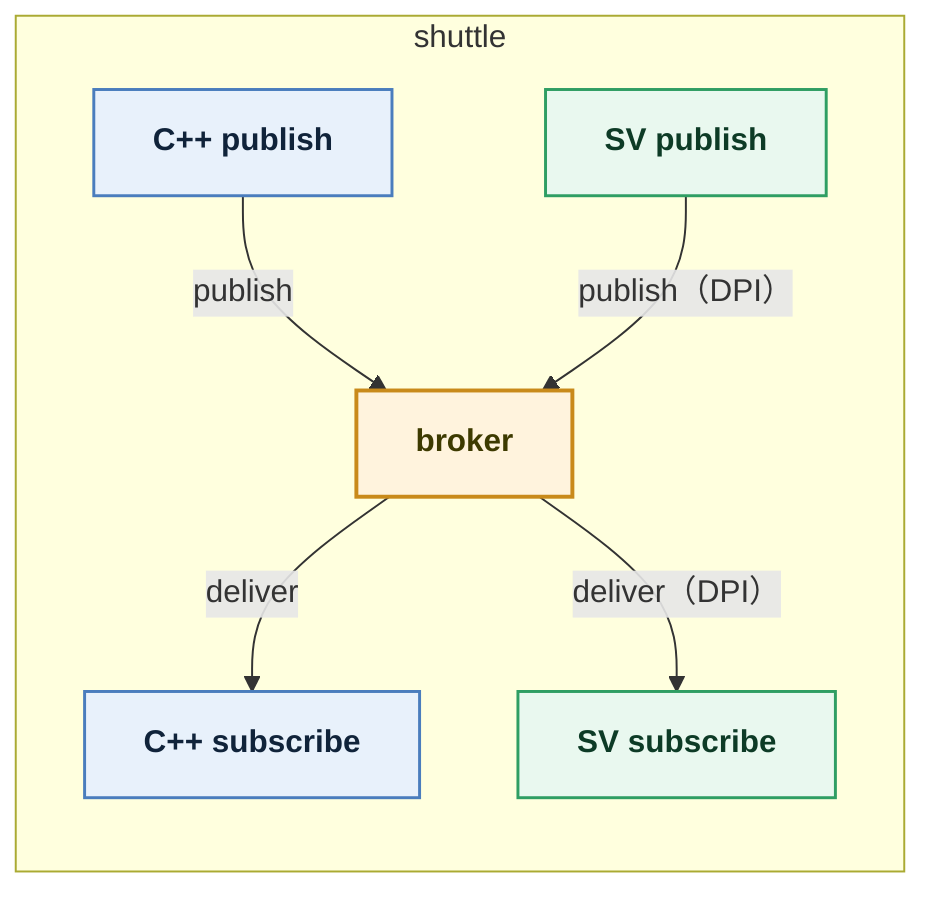

# shuttle

[English](README.md) | 简体中文

面向 EDA 验证环境的**类型化发布-订阅框架**。C++ 组件、SystemVerilog 组件、以及 C++ ↔
SV 的跨语言通信，都走同一个 broker、同一套类型系统和同一套投递语义，后端可选 `svdpi`
或 `systemc`。



所有路径都经过同一个 broker：同语言投递不需要桥，跨语言投递穿过 DPI 边界（svdpi
后端）。shuttle 不是 RPC 框架、不是总线功能模型、也不是 UVM 的某一层——它只负责一件
事：一帧该被哪些匹配的订阅者调用、什么时候调用、走哪个入口、以及每个结局如何记账。
所有并发编排（任务、时间、事件）都委托给
[weave](https://github.com/kpskp77/weave)。

## shuttle ↔ 主题式消息映射

shuttle 的 API 语义沿用主题式发布-订阅（NATS 风格的 topic、MQTT 风格的 retained），
调度形态借自 asyncio；下表是完整对照表，差异列在[模型差异](#模型差异相对普通发布订阅必读)
之下。

| shuttle | 熟悉模型 | 说明 |
|---|---|---|
| topic 名 `uart.rx` | NATS subject | 段间用 `.` 连接；发布侧只允许具体名字 |
| 订阅模式 `uart.*` / `uart.>` | NATS 通配符 `*` / MQTT `+` | `*` = 恰好一段，`>` = 任意尾段（必须在末段）。不是 MQTT `+`/`#` |
| `Publisher<T>` + `subscribe<T>` | 主题生产者 / 消费者 | topic 在首次声明时绑定类型标签；标签不匹配抛 `TypeMismatchError` |
| `publish_serial` | 有序主题投递 | 按 topic 先进先出、后台执行；回调按顺序执行 |
| `publish_concurrent` | 扇出 | 订阅者并行执行，每个订阅者内部保序 |
| `publish_now` | 内联请求/应答式发布 | nonblocking 入口在发布者栈上同步执行；blocking 入口按 `NowPolicy` 处理 |
| `NowPolicy{reject,skip,defer}` | ——（无对应物） | `publish_now` 如何处置回调可能消耗仿真时间的订阅者 |
| retained topic（`set_retained(true)`） | MQTT retained message | 新订阅者注册时立刻补发最新一帧 |
| `Meta{topic_name, topic_seq, time_fs, corr_id}` | 主题 + 位移 + 时间戳 | `topic_seq` 按 topic 从 1 起编——帧身份就是 `(topic_name, topic_seq)` |
| blocking / nonblocking 入口 | ——（无对应物） | 注册时决定：回调能否消耗仿真时间 |
| `Publication` 句柄计数 | ——（无对应物） | 每帧：targets / finished / skipped / deferred / retired / failures |
| `Trigger`（`after(event/task/duration/edge)`、`after_all/any`） | asyncio 式调度延迟 | 后台发布何时启动 |
| `Mailbox<T>` | mailbox / 队列 | 一个自带有限队列的 nonblocking 订阅者；溢出策略逐邮箱配置 |
| `Requester` / `serve`（SV：`shuttle_requester` / `shuttle_publisher::reply`） | 双主题上的请求/应答 | 关联号走帧头（`Meta::corr_id`），不进你的载荷；一个 id 计数器与一处响应 topic 标记同时服务两种语言 |

### 模型差异（相对普通发布订阅，必读）

对照表之外还有三处结构性差异；大多数误用都源于这三条：

- **回调跑在仿真进程里，而仿真进程是协程，不是线程。** 任一 CPU 时刻只有一个仿真
  进程在执行，且不会被抢占；一个回调会一直执行到下一个挂起点。broker 里没有任何
  锁，回调"阻塞"冻结的是自己的进程，不是某个线程。
- **入口能力决定回调可以跑在哪里，且在注册时定死。** `blocking` 入口（C++
  `subscribe(fn)`、SV `shuttle_subscribe`）可以消耗仿真时间，由后台链投递；
  `nonblocking` 入口（`nb(fn)`、`shuttle_subscribe_nb`）必须零延迟，也是
  `publish_now` 唯一能同步调用的类型。没有运行时开关；想要两个入口就注册两次。
- **每一帧的结局都被记账。** 每个目标恰好落在一个终态——delivered、failed、retired
  （快照后被退订）、skipped（策略）或 deferred——`Publication` 句柄把它们全部暴露。
  `wait()` 返回是对计数值的陈述，不是愿望。

## 已知偏离

- 通配符是 `*`（一段）和 `>`（末段尾通配），NATS 风格——不是 MQTT `+`/`#`。发布与声明
  接口直接拒绝含通配符的名字（`TopicPatternError`）。
- retained 是每个 topic 只存最新一帧的锁存器，在订阅时同步补发；没有 retained 历史，
  也没有 QoS 档位。
- 没有持久会话和离线缓冲：订阅者只收到注册之后发布的帧（外加 retained 帧，若有）。
  退订立即生效，对在途帧同样生效（记为 `retired`）。

## 快速上手

最小端到端示例，裁剪自 [`examples/shuttle_demo_publish.cpp`](examples/shuttle_demo_publish.cpp)
（已与真实示例核对；完整文件另含另外两种发布方式、retained、通配符与 introspection）：

```cpp
#include <shuttle/shuttle.hpp>

struct UartTx { std::uint32_t addr, data; };
SHUTTLE_REFLECT(UartTx, addr, data)              // 类型标签 + 编解码

shuttle::Publisher<UartTx> pub("uart0.tx");      // 绑定该 topic 的类型
auto mon = shuttle::subscribe<UartTx>("uart0.tx",
    [](const UartTx& tx, const shuttle::Meta& m) { /* blocking 入口：可以等待 */ });

pub.publish_now(UartTx{0x10, 0xA5}, shuttle::NowPolicy::skip);  // 同步段：只调 nb 入口
auto h = pub.publish_serial(UartTx{0x11, 0x5A});                // 后台，按 topic 先进先出
h.result();                                                     // 等待并抛出首个失败
```

```systemverilog
class monitor implements shuttle_sink;                       // blocking 入口
  virtual task invoke(input byte payload[], input shuttle_meta meta);
    UartTx tx = UartTx::unpack(payload);                     // {>>{...}} 打包
  endtask
endclass

shuttle_subscription sub = shuttle_subscribe("uart0.tx", mon, UartTx::type_tag);
shuttle_publisher #(UartTx) pub = new("uart0.tx");
shuttle_handle h = pub.publish_serial(tx);
h.wait_done();                                               // 挂起本 SV 进程
```

消息类型可以嵌套，也可以继承。嵌套把成员自己的 codec 就地展开；继承把每一层的基类子对象交给基类的
codec 编解码，同一个字段只在声明处写一次：

```cpp
struct Frame { std::uint32_t seq; };
struct Pkt : Frame { std::uint32_t data; };
SHUTTLE_REFLECT(Frame, seq)
SHUTTLE_REFLECT_DERIVED(Pkt, Frame, data)   // 线格式 = Frame 编码 + data
```

```systemverilog
class Pkt extends Frame;
  int unsigned data;
  `shuttle_reflect_begin(Pkt)
    `shuttle_base(Frame)                     // Frame::pack_obj / unpack_into
    `shuttle_field(data, shuttle_u32)
  `shuttle_reflect_end
endclass
```

端到端跑一遍（SV 演示从 SV 侧跑同一情景；两侧在同一个 broker 上汇合）：

```bash
just example-sc    # systemc 后端本地跑；末行 "WEAVE TEST PASSED"
just example-vcs   # svdpi 后端 + 真实 VCS；以 "SHUTTLE CPP DEMO PASSED" 为判据
```

预期输出中两侧交错——SV 订阅者收到 SV 发布和 C++ 发布各一帧，C++ 订阅者收到 C++ 发布，
broker 计数收尾：

```
[monitor] seq=2 addr=0x00000011 data=0x0000005a   ← SV 订阅者收到 SV 发布
[monitor] seq=4 addr=0x00000011 data=0x0000005a   ← SV 订阅者收到 C++ 发布
[async]   seq=4 addr=0x00000011 data=0x0000005a   ← C++ 订阅者收到 C++ 发布
[raw] topic=uart0.tx payload=8 bytes
[broker] topic=uart0.tx type=UartTx subs=6 published=8 delivered=20
SHUTTLE CPP DEMO PASSED
```

`seq` 是按 topic 编号的 `topic_seq`：跨语言单调，出现跳号即丢帧。每个示例文件练什么：
[examples/README.md](examples/README.md)。

## 第一个失败的诊断

新用户最先踩的是**挂死：回调在等一帧只能由它自己投递的帧**。`serial`/`concurrent`
按链先进先出，所以在回调里向自己的 topic 发布并 `wait()` 新帧，必然死锁。shuttle 在
等待处给出诊断：C++ 抛 `weave::DeadlockError`（记为常规 `Failure`），SV 侧
`wait_done()` 返回 `SHUTTLE_WAIT_FAILED`，诊断文本在 `shuttle_c_last_error()` 里。合法
的近亲用法——回调里只发布不等待（中继）——工作正常，所以检查只能放在等待点。中继到
别的 topic，或者用 `Mailbox`。

其余问题都能从计数读出：`h.failures()` 列出每个失败目标的 `{subscriber, error}`，
`shuttle_c_last_error()` / `shuttle::last_error()` 保存最近一次立即调用的失败，
`shuttle::broker::topic_info(name)` 给出逐 topic 的
`published`/`delivered`/`dropped`（含 `retired`/`skipped`/`failed` 分解）。打出通过标记
但"看着慢"的 run 是半死锁——先比 `finished()` 和 `subscriber_count()` 再下结论。

## 依赖与 xmake 集成

shuttle 及其全部依赖项都在同一个仓库 [`kpskp77/xmake-repo`](https://github.com/kpskp77/xmake-repo)
里以 xmake 包发布。先注册仓库（全局注册一次，或在 `xmake.lua` 里按项目注册）：

```console
$ xrepo add-repo eda https://github.com:kpskp77/xmake-repo.git
```

```lua
add_repositories("eda https://github.com:kpskp77/xmake-repo.git")  -- 也可以写 https:// 地址，不必配 SSH key
```

然后依赖 weave：`backend` 配置决定它针对哪个内核构建，并顺带把对应的包拉进来：

```lua
add_requires("shuttle 0.1.0", { configs = { backend = "svdpi" } })  -- 或 backend = "systemc"

target("my_test")
    set_languages("c++17")
    set_kind("shared")            -- svdpi：仿真器用 -sv_lib 加载该 target
    add_files("src/*.cpp")
    add_packages("shuttle")
```

要求：xmake ≥ 2.8、C++17 编译器，svdpi 后端另需对应仿真器。

包不覆盖两件事：

- **SV 侧。** `sv/shuttle_pkg.sv` 随 shuttle 源码树发布，不在包里（包只装头文件和库）：
  在 `weave_pkg.sv` 之后、测试平台之前编译，然后 `import shuttle_pkg::*;` 在其中构造
  publisher/subscriber。SV 消息类必须与 C++ struct 镜像：同名字段、同顺序、同
  `type_tag`，用 `{>>{...}}` 打包。
- **运行时库路径。** `libweave`/`libsimlog`（以及 `libspdlog`）是动态库，任何加载
  `libshuttle.so` 的东西——包括 `simv`——都要能找到它们：用 `xmake run` 启动（它把包
  目录放进搜索路径），或自行导出这些目录。不要把库拷到 simv 旁边。

## 构建与验证本仓库

```bash
just example-sc    # systemc 后端本地跑；末行 "WEAVE TEST PASSED"
just example-vcs   # svdpi 后端 + 真实 VCS；以 "SHUTTLE CPP DEMO PASSED" 为判据
just example-all   # 两个后端各跑一遍示例
just test-all      # 完整测试套件（systemc + VCS）
```

没有 VCS 的机器上 `tests/run-eda.sh` 打印 `[svdpi-test] skipped` 并以 0 退出，所以
`just example-vcs`（以及 `just test-vcs`）在那类环境下降级为仅编译通过——这算通过，不算失败。

## 语言标准：C++17 起

库以 **C++17** 构建（`set_languages("c++17")` 是唯一开关），公开 API 在 C++17 下完整。
ABI 说明：`Meta::topic_name` / `Meta::type_tag` 是指向 broker 内部存储的
`std::string_view`——升级 `libshuttle.so` 需要按新头文件重编用户翻译单元（语义不变，
布局变了）。

## 目录布局

```
include/shuttle/    公开 API：shuttle.hpp（伞头）+ publisher/subscription/publication/
                    mailbox/requester/trigger/codec/meta/types/broker；detail/ = 稳定 ABI 层
src/                后端无关翻译单元（publication、subscription、introspection、
                    exception、trigger）——不认识 DPI
src/broker/         broker 内部：model、路由/校验/绑定、dispatch 调度
src/backend/        后端边界（backend.hpp，5 入口）+ 恰好一个后端目录
                    （svdpi：桥 + DPI 面 + facade；systemc：退化桥）
sv/                 shuttle_pkg.sv——SV 侧包（在 weave_pkg.sv 之后编译）
examples/           覆盖整个公开 API 的逐特性演示，含两种语言与预期输出（一个对象一个文件，
                    由 shuttle_demo.cpp/.sv 顺序调用）
tests/              测试套件，两种语言都是每个套件一个对象文件，由 tests/shuttle_tests.cpp / .sv
                    顺序调用；VCS 运行器 tests/run-eda.sh
docs/               architecture.md / backends.md 及中文孪生（README_zh.md、docs/*_zh.md）
```

## 延伸阅读

- [architecture](docs/architecture.md)：broker 模型——快照语义、三种发布路径、终态记账、关键设计决策
- [backends](docs/backends.md)：DPI 协议（import/export 表、线上格式）、systemc 后端、ABI 说明
- [AGENTS.md](AGENTS.md)：每次改动都要对照的约束清单
